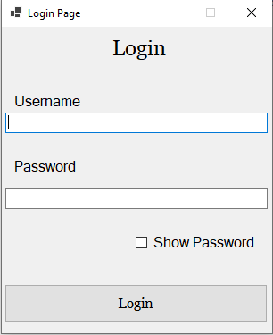
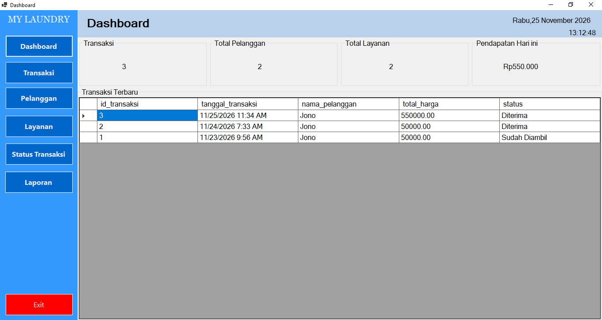
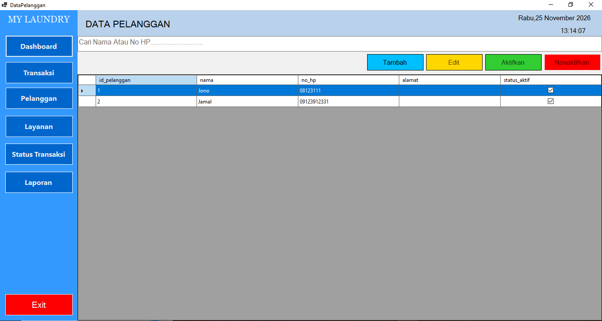
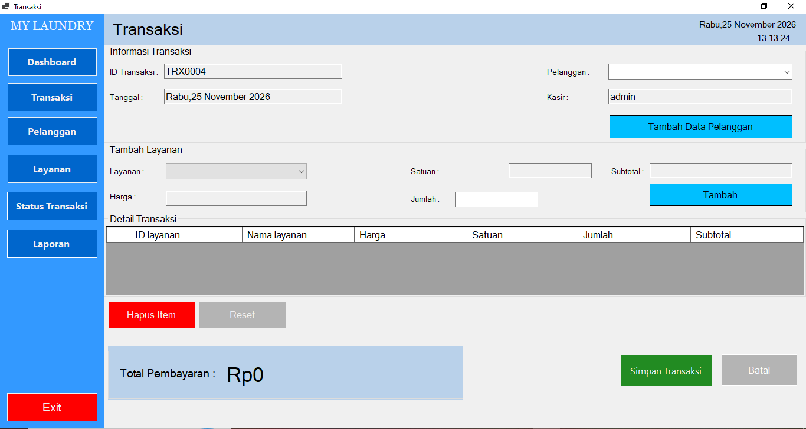
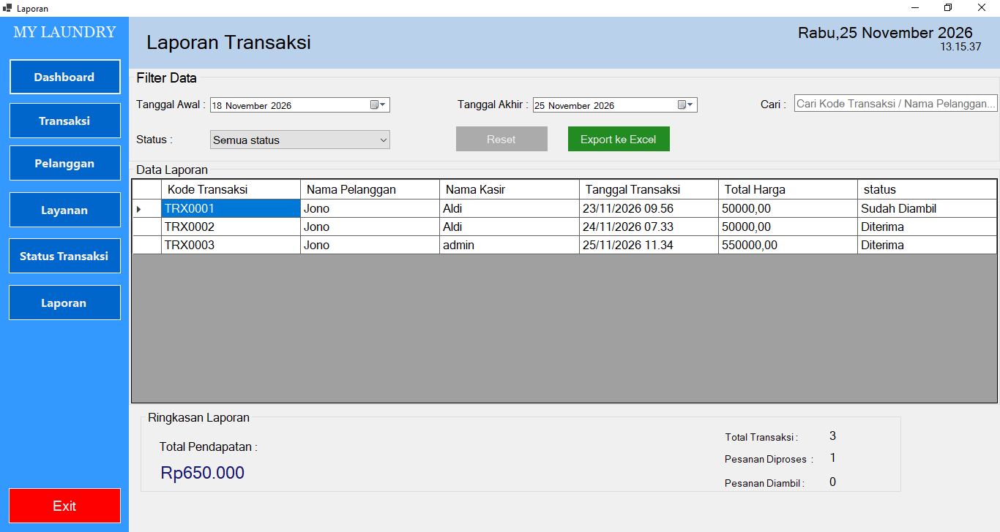

🧺 My Laundry

My Laundry adalah aplikasi manajemen laundry berbasis desktop yang dikembangkan menggunakan C# Windows Forms dan Microsoft SQL Server. Aplikasi ini dibuat untuk membantu proses pengelolaan data pelanggan, layanan laundry, transaksi, serta laporan secara lebih terstruktur.

📌 Fitur Aplikasi

Login & Hak Akses – Sistem login dengan pembagian role Admin dan Kasir.

Dashboard – Menampilkan ringkasan informasi operasional laundry.

Manajemen Pelanggan – Menambah, mengubah, mencari, dan mengelola status pelanggan.

Manajemen Layanan – Mengelola jenis layanan, satuan, dan harga.

Transaksi Laundry – Membuat transaksi dan menyimpan detail layanan.

Status Transaksi – Mengelola status pengerjaan laundry.

Laporan – Menampilkan laporan transaksi berdasarkan periode dan status.

Export Excel – Mengekspor laporan transaksi ke file Excel.

🛠️ Teknologi yang Digunakan

C#

.NET Windows Forms

Microsoft SQL Server

Microsoft.Data.SqlClient

ClosedXML

Visual Studio

🗄️ Database

Aplikasi ini menggunakan Microsoft SQL Server sebagai sistem manajemen database.

Database utama bernama LayananLaundry, dengan tabel:

users

pelanggan

layanan

transaksi

detail_transaksi

🚀 Instalasi dan Penggunaan

Unduh aplikasi melalui bagian Releases.

Ekstrak file ZIP aplikasi.

Pastikan Microsoft SQL Server sudah terpasang.

Restore database menggunakan file LayananLaundry.bak yang tersedia di folder Database.

Sesuaikan connection string dengan konfigurasi SQL Server pada komputer.

Jalankan LayananLaundry.exe.

📸 Screenshot Aplikasi

Login

Dashboard

Data Pelanggan

Data Layanan

Transaksi

Update Status Transaksi

Laporan

📦 Download

My Laundry v1.0.0
⬇️ Download My Laundry v1.0.0 (ZIP)

https://github.com/ArvinSyafiqNararya/LayananLaundry/releases/tag/v1.0.0

Download Source Code (ZIP)

https://github.com/ArvinSyafiqNararya/LayananLaundry/archive/refs/tags/v1.0.0.zip

Download Source Code (TAR.GZ)

https://github.com/ArvinSyafiqNararya/LayananLaundry/archive/refs/tags/v1.0.0.tar.gz

👨‍💻 Developer

Dikembangkan sebagai proyek pembelajaran dan portofolio untuk meningkatkan kemampuan dalam pengembangan aplikasi desktop menggunakan C# dan SQL Server.

My Laundry | Desktop Laundry Management Application
